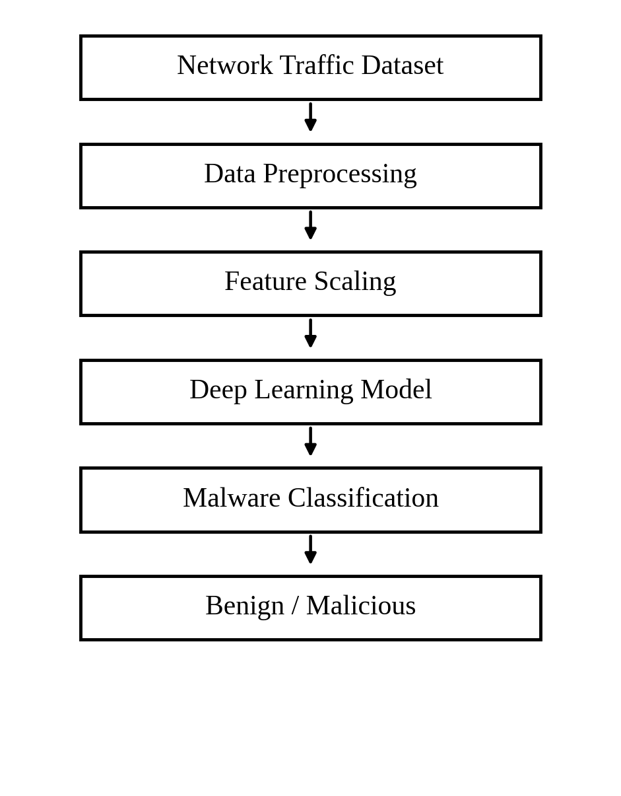
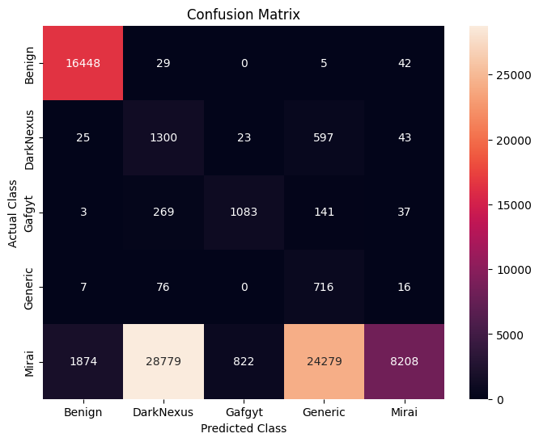
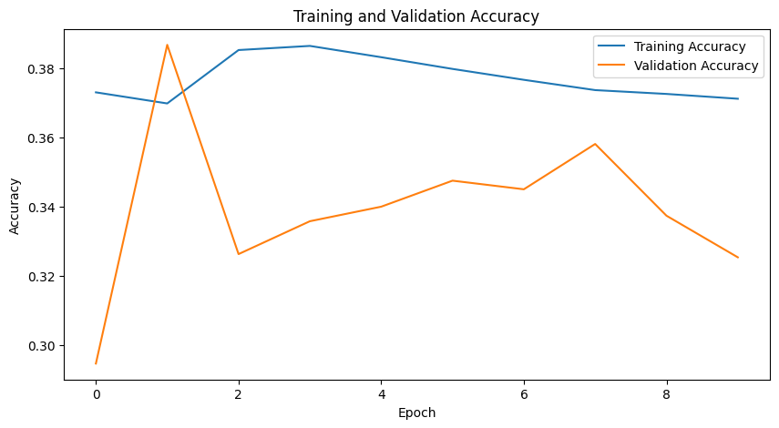
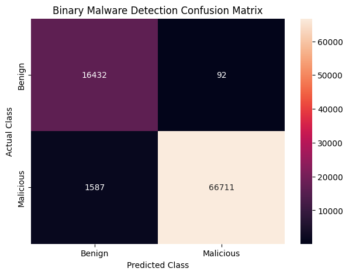
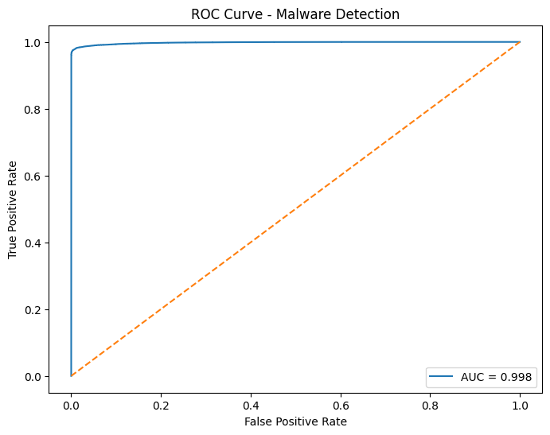
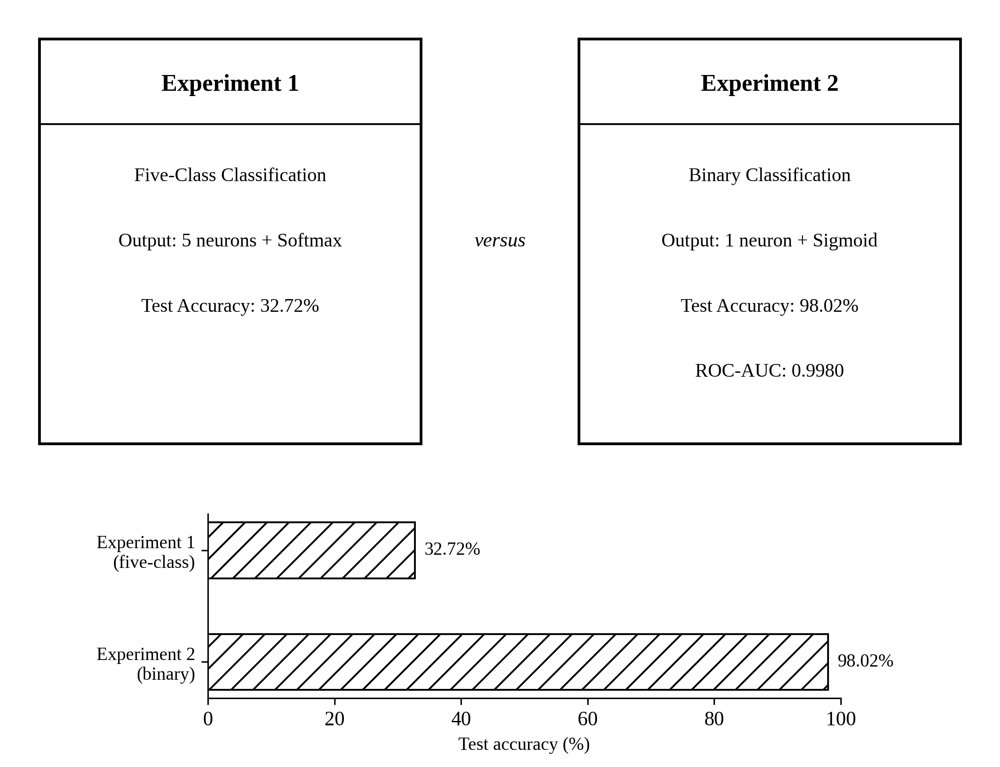

# Deep Learning-Based Cybersecurity Threat Detection Using Network Traffic

Design Experience project, B.Tech. Information Technology, SVKM's NMIMS, MPSTME Shirpur Campus (2026–2027).
Faculty guide: Vinod Waikar.

**Team:** Adivya Kumar Singh (A237), Sarthak Salot (A228), Dhruvit Patel (A212), Vaibhav Raghuvanshi (A218), Aryan Raghuvanshi (A214), Vedansh Kanoongo (A253), Yuvraj Kale (A210)

## Project Overview

This project trains small neural networks on network-traffic data to find out whether traffic comes from benign programs or from IoT malware. We ran two experiments on the same prepared data: first a five-class experiment that tries to name the malware family, and then a binary experiment that only decides Benign or Malicious. We also built a small interactive detector with `ipywidgets` inside the Colab notebook.

The whole project was done in one Google Colab notebook (`cybersecurity_threat_detection.ipynb`). The full write-up is in `docs/Design_Experience_Project_Report.pdf`.

## Problem Statement

Given a row of network-traffic features, classify the traffic as:

- one of five classes (Benign, DarkNexus, Gafgyt, Generic, Mirai) in the **multiclass experiment**, or
- **Benign vs Malicious** in the **binary experiment**.

## Dataset

**CIC-YNU-IoTMal Dataset 2026** (Canadian Institute for Cybersecurity, University of New Brunswick, with Yokohama National University). It is a 2026 IoT malware dataset, not one of the older CIC IoT datasets. We used only the **x86 PCAP** network-traffic file.

| Item | Value |
|---|---|
| Raw shape | 455,641 rows, 42 columns |
| Records labelled `Unknown` (removed) | 31,531 |
| After removing `Unknown` | 424,110 rows |
| After dropping `Hash` and `Arch` | 424,110 rows, 40 columns |
| Input features | 39 |
| Target | `MalwareFamily` |

Class counts after cleaning: Mirai 319,808, Benign 82,622, DarkNexus 9,938, Gafgyt 7,666, Generic 4,076.

The raw dataset is **not** in this repository. See [`data/README.md`](data/README.md) for how to get it.

## Technologies

Checked against the imports in the notebook:

- Python 3 and Google Colab (`google.colab.files` for uploading the data)
- TensorFlow / Keras (TensorFlow 2.21.0 was printed in the notebook)
- NumPy
- Pandas
- Scikit-learn (`LabelEncoder`, `train_test_split`, `StandardScaler`, `compute_class_weight`, `classification_report`, `confusion_matrix`, `roc_curve`, `roc_auc_score`)
- Matplotlib
- Seaborn
- ipywidgets (with `IPython.display`)

## Methodology



```
Dataset
   ↓
Data Preprocessing
   ↓
Label Encoding
   ↓
Train-Test Split
   ↓
Stratification
   ↓
Feature Scaling
   ↓
Class Weight Calculation
   ↓
Multiclass Deep Learning Model
   ↓
Evaluation
   ↓
Binary Classification
   ↓
Binary Deep Learning Model
   ↓
Final Evaluation
```

1. **Data preprocessing** – the `.parquet` file was loaded, rows with the `Unknown` label were removed, the `Hash` and `Arch` columns were dropped, and the missing values in `Std` and `Variance` (483 each in the raw file) were filled with the median. Infinite values were found in the `Rate` column (378 in training, 87 in testing); they were replaced with NaN and filled with the training medians. After this, the notebook printed 0 infinite and 0 missing values for both sets.
2. **Label encoding** – `LabelEncoder` converted the class names to numbers (0 Benign, 1 DarkNexus, 2 Gafgyt, 3 Generic, 4 Mirai).
3. **Train-test split** – 80% training and 20% testing (`test_size=0.2`, `random_state=42`), giving 339,288 training and 84,822 testing rows.
4. **Stratification** – the split used `stratify` on the labels so that each class keeps the same share in both sets.
5. **Feature scaling** – `StandardScaler` was fitted on the training data and applied to the test data. Final shapes: (339288, 39) and (84822, 39).
6. **Class weights** – balanced class weights from `compute_class_weight` were used in both experiments because the classes are very unequal in size.
7. **Multiclass model** – first experiment, five classes (below).
8. **Evaluation** – test accuracy, classification report and confusion matrix.
9. **Binary classification** – after seeing the multiclass result, the labels were changed to Benign = 0 and everything else = 1.
10. **Binary model and final evaluation** – second experiment with accuracy, classification report, confusion matrix and ROC-AUC.

Both models were trained with Adam, 10 epochs, batch size 256 and a validation split of 0.2.

## Experiment 1: Multiclass Classification

```
39 Features
     ↓
Dense 64 + ReLU
     ↓
Dropout 0.2
     ↓
Dense 32 + ReLU
     ↓
Dropout 0.2
     ↓
Dense 5 + Softmax
```

Classes: 0 = Benign, 1 = DarkNexus, 2 = Gafgyt, 3 = Generic, 4 = Mirai. Loss: sparse categorical crossentropy.

**Test accuracy: 32.72%.** This experiment did not work well. Benign traffic was recognised well (recall 1.00), but the model had difficulty telling the malware families apart. Most of the 63,962 Mirai test records were predicted as DarkNexus (28,779) or Generic (24,279), and only 8,208 were predicted as Mirai. The classes are also very unbalanced (Mirai is about 75% of the data, Generic about 1%).

| Class | Precision | Recall | F1-score |
|---|---|---|---|
| Benign | 0.90 | 1.00 | 0.94 |
| DarkNexus | 0.04 | 0.65 | 0.08 |
| Gafgyt | 0.56 | 0.71 | 0.63 |
| Generic | 0.03 | 0.88 | 0.05 |
| Mirai | 0.98 | 0.13 | 0.23 |





## Why Binary Classification Was Also Done

- **Multiclass** asks: *which malware family is this?*
- **Binary** asks: *is this traffic Benign or Malicious?*

Our first model could not separate the malware families, so we also tried the simpler question of whether traffic is benign or malicious. The binary labels are 0 = Benign and 1 = Malicious (all four malware families together). This experiment is about the basic detection problem. It is a different task from the multiclass one, not a replacement for it, and the two accuracy numbers should not be compared as if they measured the same thing.

## Experiment 2: Binary Classification

```
39 Features
     ↓
Dense 64 + ReLU
     ↓
Dropout 0.2
     ↓
Dense 32 + ReLU
     ↓
Dropout 0.2
     ↓
Dense 1 + Sigmoid
```

The output is **1 neuron with a sigmoid** because there are only two classes: the sigmoid gives a single probability between 0 and 1 that the traffic is malicious. A threshold of 0.5 turns it into BENIGN or MALICIOUS. Loss: binary crossentropy.

Binary confusion matrix (test set):

| | Predicted Benign | Predicted Malicious |
|---|---|---|
| **Actual Benign** | 16,432 | 92 |
| **Actual Malicious** | 1,587 | 66,711 |

| Class | Precision | Recall | F1-score |
|---|---|---|---|
| Benign | 0.91 | 0.99 | 0.95 |
| Malicious | 1.00 | 0.98 | 0.99 |





## Results

| Experiment | Task | Classes | Test Accuracy |
|---|---|---|---|
| Multiclass DNN | Malware-family classification | 5 | 32.72% |
| Binary DNN | Benign vs Malicious | 2 | 98.02% |

Binary model: test loss 0.0551, **ROC-AUC = 0.9980** (printed as 0.9979768335 in the notebook).



### How to read the 98.02%

The binary model achieved 98.02% accuracy on the held-out test data used in this experiment. This does not mean the model is perfect or ready for production use. On the test set it still missed 1,587 of 68,298 malicious records and flagged 92 of 16,524 benign records as malicious. It was evaluated on one dataset (x86 PCAP only) and was not tested on traffic from outside this dataset. The test split was made at row level (stratified, `random_state=42`).

`results/binary_training_curves.png` is an extra figure. The notebook only printed the binary training log and did not plot it, so we redrew the curves from the printed values.

## Interactive Detector

The notebook has a small `ipywidgets` interface ("AI Cyber Threat Detector") with a dropdown (Benign Traffic / Malicious Traffic) and an **Analyze Traffic** button. It takes the first test sample of the chosen type, scales it, gets the probability from the binary model and prints the prediction and confidence. Outputs in the notebook: benign sample → BENIGN, 95.60%; malicious sample → MALICIOUS, 100.00%. The detector works on samples from our own test set; it does not read live traffic.

## Saving the Model and the Scaler

The notebook saves the binary model with:

```python
binary_model.save("cyber_threat_detector.keras")
```

**The `StandardScaler` was not saved in the notebook.** A new record has to be scaled with the same scaler that was fitted on the training data before it goes into the model, so both files are needed for consistent future predictions. To save the scaler, run this in the notebook after the scaling and training cells (in the same session, where the variable `scaler` is the one used for training):

```python
import joblib
joblib.dump(scaler, "scaler.pkl")
```

Loading both later:

```python
import joblib, tensorflow as tf
model = tf.keras.models.load_model("cyber_threat_detector.keras")
scaler = joblib.load("scaler.pkl")
```

Loading was not run in our notebook, so this snippet is untested.

> `cyber_threat_detector.keras` and `scaler.pkl` are **not included in this repository yet** because the files were not part of the material available when the repository was prepared. Re-run the notebook (or open the Colab session that saved the model), then add them to the repository root.

## Repository Structure

```
├── README.md
├── requirements.txt
├── cybersecurity_threat_detection.ipynb
├── results/        (figures taken from the notebook outputs)
├── docs/           (architecture diagram and the project report)
├── data/README.md  (how to get the dataset)
└── .gitignore
```

## How to Run

1. Get the x86 PCAP file from the CIC-YNU-IoTMal 2026 page (see `data/README.md`).
2. Open `cybersecurity_threat_detection.ipynb` in Google Colab and upload `pcap.parquet` when asked.
3. Run the cells from top to bottom.

To run locally, install `requirements.txt` and replace the Colab upload cell with a path to the file.

## Reference

Dataset page: https://www.unb.ca/cic/datasets/ynu-iot-2026.html. The report in `docs/` lists the other references.
